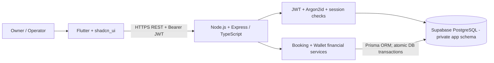

# Train Fund Manager — Project Documentation (Node.js + JWT Edition)

**Version 5.0 · 11 October 2026**  
**Status:** Complete implementation plan and architecture documents; application and backend are **not built or deployed** by this documentation.  
**Change from v4.0:** Node.js + Express.js + TypeScript + Prisma replaces Python FastAPI/SQLAlchemy/Alembic. **Supabase PostgreSQL remains database-only**; custom JWT authentication remains.

## 1. What we are building
A Flutter Android-first app for an operator who takes bulk train-ticket requests from **packagers** (external customers/agents). Each packager may have multiple bookings. One booking stores boarding station, destination, date, **a single train name OR train number input**, ticket-booking price, service charge, money actually collected, money actually deducted from the booking wallet, and automatically calculated remaining amount owed. User authentication is custom JWT. The app **tracks records** and does not book rail tickets or check ticket status.

## 2. Locked tech stack

| Layer | Technology |
|---|---|
| Mobile app | Flutter/Dart |
| Design | `shadcn_ui` **for Flutter**, not React |
| State & routing | Riverpod and GoRouter |
| API networking | Dio HTTPS REST |
| Token storage | `flutter_secure_storage` |
| Server | **Node.js (LTS) + Express.js + TypeScript** |
| Login security | Argon2id + server-issued RS256 JWT (`jose`) + rotating opaque refresh token |
| Validation | Zod |
| Database access | **Prisma ORM** with PostgreSQL adapter |
| Migrations | **Prisma Migrate** + reviewed SQL constraints |
| Database | **Supabase PostgreSQL only** (private `app` schema) |

**No Supabase Auth. No `supabase_flutter`. No Flutter DB access. No PNR, train status, booking references or passenger-wise ticket records.**

## 3. Architecture

## 4. Definitions
- **Packager:** External customer/agent; **does not log in**. One packager may have several bookings.
- **App user:** Owner/operator; logs in with our own JWT service.
- **Total payable:** Ticket booking price + service charge.
- **Total collected fund:** Net customer receipts (received payments less actual refunds/corrections).
- **Customer due/credit:** `Total payable - Total collected fund`; positive means due, negative means customer credit.
- **Fund balance:** `Ticket booking price - wallet deducted fund`. Collections and service charge are displayed separately and do not change this balance.
- **Wallet deducted fund:** Money spent through the operator's external wallet. Enter the amount on a booking; a source wallet is not required. Older app-wallet entries remain available for historical records.
- **Money:** integer paise for storage and JSON; rupees for UI. Use JS BigInt in backend with explicit safe JSON conversions.

### Example
Ticket ₹10,000 + service ₹1,000 = total payable ₹11,000. Customer has paid ₹8,500. **Balance due ₹2,500**. Wallet deduction ₹10,000 is separately tracked and must not be subtracted from the customer balance again.

## 5. Reading order

| File | Purpose |
|---|---|
| `00_README_START_HERE.md` | This start guide |
| `01_PRODUCT_REQUIREMENTS_AND_PROJECT_PLAN.md` | App features, screens and forms |
| `02_COMPLETE_SYSTEM_ARCHITECTURE.md` | Runtime diagram and trust boundaries |
| `03_DATABASE_SCHEMA_AND_SECURITY.md` | Supabase PostgreSQL tables and security |
| `04_FINANCIAL_RULES_AND_DATA_FLOW.md` | Customer, booking and wallet money flow |
| `05_ORCHESTRATION_AND_API_CONTRACTS.md` | REST endpoints and protected transaction flows |
| `06_FLUTTER_SCAFFOLD_AND_UI_SPEC.md` | Flutter UI, state and folder structure |
| `07_MODULE_BY_MODULE_DEVELOPMENT.md` | Strict M00–M11 build order |
| `08_TESTING_SECURITY_AND_RELEASE.md` | Acceptance matrix and release quality |
| `09_AI_AGENT_IMPLEMENTATION_RULES.md` | Binding agent instructions |
| `10_LOCKED_TECH_STACK_AND_AUTH_SETUP.md` | Environment, custom JWT and package choices |
| `11_BACKEND_NODEJS_EXPRESS_JWT_IMPLEMENTATION.md` | Node/Express server and auth scaffold |
| `12_DEPLOYMENT_OPERATIONS_AND_HANDOVER.md` | Hosting, secrets, backups and launch |
| `13_PRISMA_SCHEMA_AND_TRANSACTION_PATTERNS.md` | Prisma 7 patterns, schema and transactions |

## 6. Scope assumptions
1. MVP supports one owner/operator account provisioned through an admin-only command. More users can be supported later with strict owner isolation.
2. Customer receipts, ticket costs and wallet deductions are **manual entries**, not bank or railway integrations.
3. Online-first; no offline writes of money, no automatic ticket status checking.
4. Wallet balances must never become negative through app operations; every finance write is atomic and idempotent.
5. Date fields represent local journey day (`YYYY-MM-DD`); event timestamps UTC and rendered in Asia/Kolkata.

## 7. Give this to an AI coding agent

> Read all Markdown files in this folder. Follow the locked Flutter → Node.js/Express/TypeScript → Prisma → Supabase PostgreSQL architecture. Use custom RS256 access JWT and rotating refresh tokens, **not Supabase Auth**. Preserve exact booking fields and financial ledger rules. Follow `07_MODULE_BY_MODULE_DEVELOPMENT.md` in order, complete each module's tests, and never change the stack or domain rules without approval. Start with Module M00.
