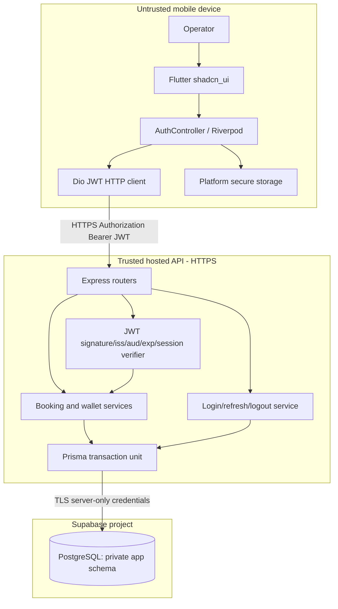
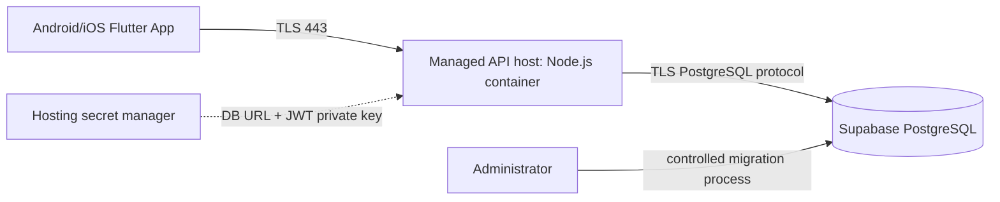

# Complete System Architecture — Custom JWT / Supabase Database Only

**Architecture decision ADR-001:** Supabase is retained **only as a PostgreSQL host**. Supabase Auth and Supabase client SDK are not part of runtime integration. A separate **Node.js/Express backend** is now necessary to securely verify passwords, issue JWTs, enforce per-user access, and hold Postgres credentials.

## 1. Technology responsibilities

| Layer | Technology | Does | Does not |
|---|---|---|---|
| Flutter UI | Dart + `shadcn_ui` | Forms, pages, local money preview | Sign JWT or run SQL |
| Flutter state | Riverpod + GoRouter | Auth gate, query state, navigation | Decide server authorization |
| Flutter transport | Dio / HTTPS | JWT Bearer REST requests, retries | Connect directly to Supabase |
| API boundary | Node.js + Express.js + TypeScript + Zod | Auth, ownership, validation, orchestration | Trust Flutter totals/owner IDs |
| Identity | Own JWT + server session tables | Login, token refresh, logout, revocation | Use `auth.users` or Supabase Auth |
| Business/domain | TypeScript services | Packager/booking/wallet actions | Commit partial finance writes |
| Persistence | Prisma ORM + Prisma Migrate | Transactions, locks, queries, migrations | Embed password in APK |
| Database | Supabase PostgreSQL | Data and immutable ledgers | Issue/revoke app JWTs |
| Exports | Flutter local libraries | Create PDF/CSV/XLSX from authorized data | Store public shared reports on server |

## 2. Request and trust architecture



**Trust boundaries:** Mobile input is untrusted. Node.js/Express is the only public data interface. JWT validation must happen on the server for every protected route, not merely in Flutter. Postgres accepts the backend DB login from an authorized server; the app does not expose the database connection string.

## 3. Authentication sequence

```mermaid
sequenceDiagram
 actor Owner
 participant Flutter
 participant API as Node.js/Express
 participant DB as Supabase Postgres
 Owner->>Flutter: Email + password
 Flutter->>API: POST /api/v1/auth/login (HTTPS)
 API->>DB: Fetch app_users + verify Argon2id password
 API->>DB: Create auth_sessions + hashed refresh token
 API-->>Flutter: RS256 access JWT (short-lived) + opaque refresh token
 Flutter->>Flutter: Store credentials in secure storage
 Flutter->>API: GET /api/v1/bookings (Bearer JWT)
 API->>API: Verify signature, alg, iss, aud, exp, typ, sid
 API->>DB: Check active session/user + owner-scoped query
 DB-->>API: Scoped rows
 API-->>Flutter: Booking JSON
 Note over Flutter,API: On expiry: POST /auth/refresh; rotate refresh token atomically
```

## 4. Backend request pipeline
1. Managed TLS ingress delivers `HTTPS /api/v1/...`.
2. Middleware sets request correlation ID, enforces request size, logs metadata without credentials, and configures CORS only if later web clients are added.
3. Protected router extracts Bearer JWT; verifier allows **only** configured algorithm and trusted key ID, validates `iss`, `aud`, `iat`, `nbf`, `exp`, `typ=access`, `sub` and `sid`.
4. Backend checks user active + session active in DB (or an explicitly documented revocation strategy).
5. Zod validates request fields, server gets owner/user ID from verified claims, **never from body**.
6. Service checks packager/wallet ownership and business constraints.
7. Prisma ORM performs atomic PostgreSQL transaction including idempotency and ledger/audit records.
8. API returns committed object/derived balance; Flutter refreshes authorized reads.

## 5. Deployment topology



- Persistent small backend: direct DB endpoint over IPv6 if available, or Supabase session pooler when deployed on IPv4-only hosts. Copy connection strings from project dashboard; never guess host.
- For serverless/many short-lived connections, evaluate Supavisor transaction pooling and driver limitations, and perform explicit concurrency tests.
- Enable SSL verification for the chosen Postgres connection and certificate, and keep database connectivity private where hosting/network options allow.
- Optional reverse proxy/ingress provided by host; **Nginx is not mandatory** in MVP.
- No Kafka, Redis, Kubernetes, or Cloudinary required for initial requirements.

## 6. Data visibility and database privilege model
- Use private schema `app` for operational tables; do not create the application's identity in Supabase `auth.users`.
- Disable Supabase Data API if feasible; otherwise **do not expose `app` schema** and revoke all `anon`, `authenticated`, `PUBLIC` privileges on application objects.
- Define a dedicated least-privileged backend database role, separate from the privileged migration/admin role; never run routine queries as `postgres` or `service_role`.
- Backend always filters by `owner_id` and validates relational ownership. Consider PostgreSQL RLS as defense-in-depth with a trusted transaction-scoped actor context, **not** `auth.uid()`.
- Secret manager holds `DATABASE_URL`, signing private key and token-hash pepper (if adopted). Only nonsecret API base URL goes into Flutter config.

## 7. Error/resilience design
- Protected endpoints reject missing/invalid JWT with 401 and insufficient ownership with 404/403 as appropriate without leaking cross-user records.
- Access JWT expires quickly; a single refresh attempt may replay the original API request once; never infinite loops.
- Financial commands require stable UUID idempotency keys to distinguish network retries from genuine new actions.
- Every wallet-changing operation locks the same wallet row and checks available balance transactionally.
- Do not operate offline financial writes. Offline may show an explicitly dated cached read-only snapshot only if later approved.

## 8. Architectural decision log
| ADR | Decision | Reason |
|---|---|---|
| ADR-001 | Own Node.js/Express backend | Custom JWT cannot safely be issued or signed in mobile app |
| ADR-002 | Supabase PostgreSQL only | User requested no Supabase Auth, only managed database |
| ADR-003 | Access JWT + opaque rotating refresh token | Short-lived JWT API auth with server-revocable longer session |
| ADR-004 | Immutable financial ledgers | Correct auditable balance recalculation |
| ADR-005 | Integer paise | Avoid money floating-point drift |
| ADR-006 | Backend-owned transaction + idempotency | Rollback and safe retries |
| ADR-007 | Owner-only MVP | Avoid speculative multi-tenant roles until requested |

## 9. References
- Supabase connection choices: https://supabase.com/docs/guides/database/connecting-to-postgres
- Supabase data protection and server-only database access: https://supabase.com/docs/guides/database/secure-data
- OWASP mobile session/token security: https://cheatsheetseries.owasp.org/cheatsheets/Mobile_Application_Security_Cheat_Sheet.html
