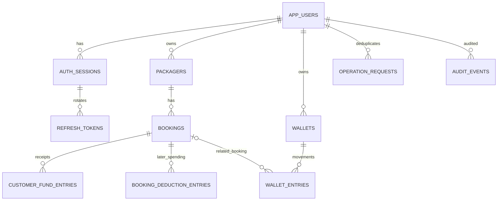

# Supabase PostgreSQL Database Schema & Security — Custom JWT Identity

**Database is the only Supabase service used.** Supabase Auth, `auth.users`, `auth.uid()`, `auth.jwt()`, Supabase Data API and mobile DB connections **must not be used** for this product. All queries originate from the authorized Node.js/Express/TypeScript backend through Prisma ORM and its PostgreSQL adapter. This is a design; applying migrations is a future implementation step.

## 1. Principles
- Create tables in **private `app` schema**, not publicly exposed API schemas; only a restricted backend DB role can access them.
- Identity table is **`app.app_users`**, managed by our own login service; **no FK to Supabase Auth**.
- User identity/owner ID is from backend-validated JWT **`sub`**, after checking session/user state. `owner_id` is assigned by backend, never trusted from client.
- Store money in **bigint integer paise** (not float/double); store `journey_date` as SQL `date`, event times as `timestamptz` UTC.
- Keep customer payments and booking-wallet transactions in distinct append-only ledgers.
- Store the initial external-wallet deduction amount on the booking. Later deductions append to `booking_deduction_entries`; neither requires an app wallet. Historical app-wallet ledger rows remain readable.
- Use UUIDs internally for DB relation and idempotency; not user-facing booking references.
- One operator account initially, but owner-separated tables avoid unsafe cross-account access if more operators are added.

## 2. Entity relationship overview



## 3. Tables

### `app_users` — custom login identity

| Column | Type | Rules |
|---|---|---|
| `id` | uuid PK | New UUID from trusted server |
| `email_normalized` | text UNIQUE NOT NULL | Normalized, lowercase email lookup |
| `password_hash` | text NOT NULL | **Argon2id encoded hash**, no plaintext |
| `display_name` | text | Optional |
| `is_active` | boolean DEFAULT true | Disabled accounts rejected |
| `password_changed_at` | timestamptz | Helps revoke old sessions |
| `created_at`, `updated_at` | timestamptz | Audited |

Passwords never go into `profiles`, JWT claims, logs or mobile settings. Initial user is created through admin-only CLI, not open signup.

### `auth_sessions` — revocable JWT-backed logins

| Column | Type | Rules |
|---|---|---|
| `id` | uuid PK | Used in access JWT `sid` |
| `user_id` | uuid FK `app_users.id` | Owner |
| `created_at`, `last_seen_at` | timestamptz | Session activity |
| `absolute_expires_at` | timestamptz | Max lifetime |
| `revoked_at` | timestamptz NULL | Revocation; deny JWT if not NULL |
| `revocation_reason` | text NULL | logout/reuse/password-change/admin |

Protected requests check both JWT validity and active session/user; avoid relying only on JWT expiry for logout.

### `refresh_tokens` — opaque rotation chain

| Column | Type | Rules |
|---|---|---|
| `id` | uuid PK | Internal |
| `session_id` | uuid FK | Parent session |
| `token_hash` | text UNIQUE NOT NULL | SHA-256 of cryptographically random token; never store raw value |
| `issued_at`, `expires_at` | timestamptz | Validity |
| `consumed_at`, `revoked_at` | timestamptz NULL | Rotation / revocation flags |
| `replaced_by_token_id` | uuid NULL FK self | Chain for reuse detection |

Refresh rotations lock session/token rows; concurrent use cannot issue two independent valid chains. Reuse triggers configured family revocation. Database administrative access remains a separate security layer.

### `packagers`
`id uuid PK`, `owner_id uuid FK app_users.id`, `name text NOT NULL`, `phone text NULL`, `notes text NULL`, `is_archived boolean default false`, `created_at`, `updated_at`. Index `(owner_id, name)` and `(owner_id, is_archived)`. Name is not globally unique.

### `bookings`

| Column | Type | Rule |
|---|---|---|
| `id` | uuid PK | Internal only |
| `owner_id` | uuid FK | Must match packager owner |
| `packager_id` | uuid FK | Scoped via `(owner_id, packager_id)` |
| `boarding_station` | text NOT NULL | Trimmed, nonempty |
| `destination_station` | text NOT NULL | Trimmed; differs case-insensitively from boarding |
| `journey_date` | date NOT NULL | Train journey local calendar day |
| `train_identifier` | text NOT NULL | **ONE field** for train name or number |
| `booking_person_mobile` | text NULL | Optional booking contact; 10–15 digits, optional leading `+` |
| `ticket_price_paise` | bigint NOT NULL | > 0 |
| `service_charge_paise` | bigint NOT NULL DEFAULT 0 | >= 0 |
| `notes` | text | Optional |
| `created_at`, `updated_at` | timestamptz | Audited |

Indexes `(owner_id, packager_id, journey_date DESC)`, `(owner_id, journey_date DESC)`. Add constraints for length bounds, nonempty fields and reasonable money maximum. The mobile field is a booking contact, not a passenger entity. Do **not** add passenger table, PNR, booking reference or ticket-status columns.

### `customer_fund_entries` — append-only actual funds ledger
`id uuid PK`, `owner_id`, `booking_id`, `entry_type` CHECK (`receipt`, `refund`, `reversal`), `amount_paise bigint CHECK > 0`, `method` (cash/upi/bank/other), `occurred_at timestamptz`, `reversal_of_entry_id uuid NULL`, `operation_request_id uuid`, `note text`, `created_at timestamptz`. Refund represents actual packager refund; reversal corrects a mistaken recorded receipt. Never silently update/delete a posted row. Original and reversal must belong to same owner/booking; prevent total reversal/refunds beyond applicable funds.

### `wallets`
`id uuid PK`, `owner_id`, `name`, `opening_balance_paise bigint CHECK >= 0`, `is_active boolean`, `created_at`, `updated_at`. Opening balance set only at creation; set guarded current balance initially equal to opening if maintaining a balance cache. Never additionally count an opening credit journal row. An archived wallet remains in history.

### `wallet_entries` — append-only wallet ledger
`id uuid PK`, `owner_id`, `wallet_id`, `booking_id uuid NULL`, `entry_type` CHECK (`top_up`, `booking_debit`, `wallet_refund`, `debit_reversal`, `manual_adjustment_credit`, `manual_adjustment_debit`), `amount_paise bigint CHECK > 0`, `occurred_at`, `reversal_of_entry_id`, `operation_request_id`, `note`, `created_at`. Validate booking link when entry type requires it, same-owner foreign keys, correction caps and no negative wallet balance.

### `operation_requests` — exactly-once intent record
`owner_id uuid NOT NULL`, `request_id uuid NOT NULL`, `operation_type text`, `payload_hash text`, `result_json jsonb`, `created_at timestamptz`, `completed_at timestamptz`; primary key `(owner_id, request_id)`. Insert/check in the **same transaction** as money writes. If payload differs for reused ID, return 409 conflict. Concurrent duplicates must not both post entries; handle uniqueness/transaction wait safely.

### `audit_events` — auditable changes
`id uuid PK`, `owner_id`, `actor_user_id`, `entity_type`, `entity_id`, `action`, `reason`, `before_json`, `after_json`, `occurred_at`. Do not record JWT, raw refresh token, password or sensitive full request bodies. Financial edits/reversals must contain a reason.

## 4. Illustrative SQL starter (not full production migration)

```sql
CREATE SCHEMA IF NOT EXISTS app;

CREATE TABLE app.app_users (
  id uuid PRIMARY KEY,
  email_normalized text NOT NULL UNIQUE,
  password_hash text NOT NULL,
  display_name text,
  is_active boolean NOT NULL DEFAULT true,
  password_changed_at timestamptz,
  created_at timestamptz NOT NULL DEFAULT now(),
  updated_at timestamptz NOT NULL DEFAULT now(),
  CONSTRAINT nonempty_email CHECK (btrim(email_normalized) <> '')
);

CREATE TABLE app.auth_sessions (
  id uuid PRIMARY KEY,
  user_id uuid NOT NULL REFERENCES app.app_users(id),
  created_at timestamptz NOT NULL DEFAULT now(),
  last_seen_at timestamptz,
  absolute_expires_at timestamptz NOT NULL,
  revoked_at timestamptz,
  revocation_reason text
);

CREATE TABLE app.refresh_tokens (
  id uuid PRIMARY KEY,
  session_id uuid NOT NULL REFERENCES app.auth_sessions(id),
  token_hash text NOT NULL UNIQUE,
  issued_at timestamptz NOT NULL DEFAULT now(),
  expires_at timestamptz NOT NULL,
  consumed_at timestamptz,
  revoked_at timestamptz,
  replaced_by_token_id uuid REFERENCES app.refresh_tokens(id)
);

CREATE TABLE app.packagers (
  id uuid PRIMARY KEY,
  owner_id uuid NOT NULL REFERENCES app.app_users(id),
  name text NOT NULL CHECK (btrim(name) <> ''),
  phone text,
  notes text,
  is_archived boolean NOT NULL DEFAULT false,
  created_at timestamptz NOT NULL DEFAULT now(),
  updated_at timestamptz NOT NULL DEFAULT now(),
  UNIQUE (owner_id, id)
);

CREATE TABLE app.bookings (
  id uuid PRIMARY KEY,
  owner_id uuid NOT NULL REFERENCES app.app_users(id),
  packager_id uuid NOT NULL,
  boarding_station text NOT NULL CHECK (btrim(boarding_station) <> ''),
  destination_station text NOT NULL CHECK (btrim(destination_station) <> ''),
  journey_date date NOT NULL,
  train_identifier text NOT NULL CHECK (btrim(train_identifier) <> ''),
  ticket_price_paise bigint NOT NULL CHECK (ticket_price_paise > 0),
  service_charge_paise bigint NOT NULL DEFAULT 0 CHECK (service_charge_paise >= 0),
  notes text,
  created_at timestamptz NOT NULL DEFAULT now(),
  updated_at timestamptz NOT NULL DEFAULT now(),
  UNIQUE (owner_id, id),
  FOREIGN KEY (owner_id, packager_id) REFERENCES app.packagers(owner_id, id),
  CHECK (lower(btrim(boarding_station)) <> lower(btrim(destination_station)))
);
```

Complete Prisma Migrate revisions must also define ledgers, owner-aligned composite FKs, indexes, uniqueness for reversals and strict transaction tests. Use DB constraints *and* backend validation; example is illustrative, not deployment-ready.

## 5. Derived queries (one row per booking)
- `payable_paise = bookings.ticket_price_paise + bookings.service_charge_paise`.
- `collected_paise = SUM(receipts) - SUM(customer_refunds) - SUM(receipt_reversals)` grouped by booking.
- `signed_balance_paise = payable_paise - collected_paise`.
- `balance_due_paise = GREATEST(signed_balance_paise, 0)`; `advance_credit_paise = GREATEST(-signed_balance_paise, 0)`.
- `wallet_deducted_paise = SUM(booking_debit) - SUM(wallet_refund) - SUM(debit_reversal)` **per booking**.
- `wallet_current_balance_paise = opening + wallet credits - wallet debits`.

**Avoid multiplying sums through joining `customer_fund_entries` and `wallet_entries` directly.** Pre-aggregate each by booking/wallet, then join aggregate rows. Per-packager summaries sum per-booking results.

## 6. Owner security strategy
1. Flutter never sends trusted owner ID; JWT `sub` identifies backend user.
2. Prisma ORM queries check `owner_id == current_user.id` for every booking, packager, wallet, statement, update and join; cross-owner resources should not be enumerable.
3. Enforce same-owner FKs to block connecting another user's wallet/packager/booking.
4. Keep `app` schema unexposed to Supabase PostgREST; disable Data API when feasible; revoke default/public grants and never grant `anon`/`authenticated` data privileges.
5. Use a least-privileged **runtime DB role**. Separate Prisma Migrate migration role from runtime role. Runtime role should not own tables, have `BYPASSRLS`, or create arbitrary functions.
6. If adding PostgreSQL RLS for defense in depth, scope policies to backend-selected `current_setting('app.owner_id', true)` with `SET LOCAL` inside the same transaction. Understand this protects against missing filters in trusted code, **not against SQL injection into a role able to change settings**. Never use `auth.uid()` because Supabase Auth is not used.
7. Add API-level object authorization tests irrespective of RLS. Do not claim Supabase authenticated/anon roles are custom JWT authorization.

## 7. Migration and safety order
1. Initialize Prisma Migrate and the PostgreSQL adapter with TLS; configure Prisma v7 connection URLs in prisma.config.ts.
2. Create `app` schema + roles/grants and `app_users`, sessions and refresh tokens.
3. Create packagers, wallets and bookings with owner composite keys.
4. Create ledger tables, request deduplication and audit.
5. Build one-row-per-entity aggregated queries/views; verify permission on views (no RLS bypass).
6. Add financial constraints/indexes, block update/delete on immutable financial entries for runtime role where feasible.
7. Run tests for concurrent booking writes, wallet insufficiency, refunds and cross-owner access.
8. Only then enable real financial use, with a backup and tested restore path.

## 8. Non-negotiable removed structures
Do not migrate Supabase `auth.users`/`profiles` auth scheme, `auth.uid()` policies, Supabase Auth user triggers or Supabase-specific auth JWTs. Do not create PNR, train status, reservation reference, traveler/passenger entity or vendor-booking states.

## 9. Prisma-specific implementation notes (Node.js edition)
- Generate Prisma 7 `prisma-client` into `backend/generated/prisma`; use `@prisma/adapter-pg` with `pg` only in backend runtime. `datasource db { provider = "postgresql"; schemas = ["app"] }` plus `@@schema("app")` for each model (use separate lines, valid Prisma syntax).
- Migration connection is configured by `MIGRATION_DATABASE_URL` in Prisma config; runtime adapter uses `DATABASE_URL`. Commit generated SQL migrations; run them as controlled CI tasks.
- Use PostgreSQL `BIGINT` for paise → Prisma `BigInt` → JS `bigint`, with explicit JSON safe-number/string serialization and bounds checks. Money fields cannot use floating point.
- Add SQL checks, immutability enforcement, safe permissions and composite owner FKs in reviewed migration SQL when Prisma Schema Language cannot express them.
- `wallets` may also maintain a guarded `current_balance_paise` cache initialized from opening funds. All mutations must update it together with an immutable `wallet_entries` journal row under the same locked transaction; periodically reconcile against the journal.
- See `13_PRISMA_SCHEMA_AND_TRANSACTION_PATTERNS.md` for example model declarations and migration commands.
