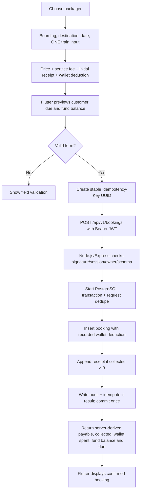
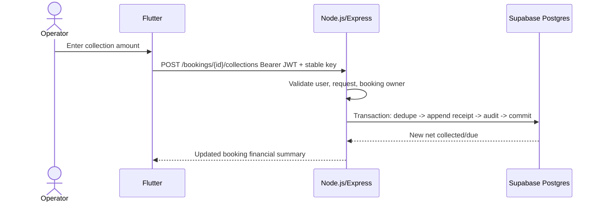

# Authoritative Financial Rules and Complete Data Flow

**Version 5.0 stack:** Flutter shadcn UI → **Node.js/Express REST with backend-verified access JWT** → **Supabase PostgreSQL only**. The Node.js/Express backend and PostgreSQL transactions through Prisma are the financial source of truth. Do not call Supabase Data API/RPC directly from Flutter.

## 1. Money representation
- Display INR (`₹`) but calculate in **integer paise** from request validation to SQL queries, including API response fields.
- Convert decimal string inputs (`8500`, `8500.00`, `8500.50`) to integer paise without floating-point math. Reject `12.345`, negative amounts where forbidden, NaN and huge unapproved values.
- `journey_date` is date-only; payment/wallet event `occurred_at` is UTC instant, displayed in Asia/Kolkata.

## 2. Authoritative equations

```text
T = Train Ticket Booking Price (paise)                  T > 0
S = Service Charge (paise)                              S >= 0
P = Total Payable = T + S

R = SUM(customer_fund_entries: receipt)
F = SUM(customer_fund_entries: refund)
X = SUM(customer_fund_entries: reversal)
C = Net Total Collected Fund = R - F - X

SignedBalance = P - C
BalanceFundDue = max(SignedBalance, 0)
AdvanceOrCredit = max(-SignedBalance, 0)

D = booking.recorded_wallet_deduction_paise
    + SUM(booking_deduction_entries: later recorded deductions)
    + SUM(wallet_entries: booking_debit linked to booking, for historical app-wallet records)
WR = SUM(wallet_entries: wallet_refund linked to booking)
WX = SUM(wallet_entries: debit_reversal linked to booking)
WalletDeductedFund = D - WR - WX
FundBalance = T - WalletDeductedFund

WalletCurrentBalance = OpeningBalance
                       + TopUps + WalletRefunds + DebitReversals + AdjustmentCredits
                       - BookingDebits - AdjustmentDebits
```

**Fund balance** is ticket booking price minus recorded wallet spending. Collections and service charge do not enter that equation. **Customer due** remains a separate amount based on ticket price, service charge and collections; wallet spending does not reduce customer due. The service charge billed is not automatically actual cash profit.

## 3. Example

| Item | Amount |
|---|---:|
| Packager | ABC Travels |
| Boarding → Destination | Kozhikode → Chennai |
| Journey date | 2026-10-25 |
| One train input | 12626 |
| Ticket booking price | ₹10,000 |
| Service charge | ₹1,000 |
| **Total payable** | **₹11,000** |
| Funds received initially | ₹8,500 |
| Wallet deduction | ₹10,000 |
| **Fund balance** | **₹0** |
| **Balance due from packager** | **₹2,500** |

The operator enters the ₹10,000 deduction directly, without selecting an app wallet. A later packager payment of ₹2,500 makes customer due ₹0; fund balance remains ₹0 because collections do not enter that calculation. It does not automatically top up any wallet.

For a ₹23,541 ticket with a ₹23,180 wallet deduction, fund balance is ₹361 even if ₹23,950 was collected and ₹409 was charged for service.

## 4. Login and authenticated data flow

```mermaid
sequenceDiagram
 actor User
 participant UI as Flutter
 participant API as Node.js/Express Auth
 participant DB as Supabase PostgreSQL
 User->>UI: Enter email/password
 UI->>API: POST /api/v1/auth/login
 API->>DB: Load app_user; Argon2id verification
 API->>DB: Create session and hashed refresh token
 API-->>UI: JWT access + random refresh
 UI->>UI: Securely store refresh; keep access in memory
 UI->>API: GET /api/v1/packagers (Bearer JWT)
 API->>API: Verify JWT claims/signature and session active
 API->>DB: Owner-scoped SELECT
 DB-->>API: Rows
 API-->>UI: Packager list
```

## 5. New booking: end-to-end command



No source wallet is required for a recorded deduction. Initial collection = 0 means **no receipt ledger entry**. A nonzero initial deduction is stored on the booking without changing an app wallet. Later deductions append immutable entries through `POST /bookings/:id/deductions`. Older clients may still supply a wallet ID and use the legacy wallet ledger. Failure at *any* point means **no booking or money rows** persist.

## 6. Add a later customer payment



If owed ₹2,500 and packager pays ₹1,000, remaining due is ₹1,500. Allow an overpayment as an explicitly displayed **credit**, not a negative due label. Customer receipts do not move money into wallet automatically.

## 7. Wallet activities
- **Recorded deduction:** enter an external-wallet spending amount at booking creation or later through the booking detail action. It changes fund balance, not customer due, and does not require or change an app wallet.
- The operations below apply to legacy app-wallet accounts and entries.
- **Top-up:** actual credit added manually; wallet increases, no customer collection implied.
- **Booking debit:** actual spending from wallet, requires wallet+booking; wallet decreases and net wallet-spent metric increases.
- **Actual wallet refund:** credit from wallet provider, recorded to the booking when applicable; wallet increases and net booking wallet deduction decreases; customer due unaffected.
- **Debit reversal:** correct entry that never happened. Require reference and reason; journal new credit, never modify original debit.
- **Manual adjustment:** audited exceptional credit/debit with reason; must not allow negative available balance.
- **Customer refund:** actual money returned to packager; net collected goes down and due increases. Does not automatically alter wallet.
- **Receipt reversal:** remove erroneous receipt from *accounting* using linked counter-entry; not an actual refund movement.

**Concurrency:** wallet-changing operations lock the wallet parent row `SELECT ... FOR UPDATE` before recomputing available amount and writing entry. With ₹5,000 balance, two parallel ₹4,000 debits cannot both succeed.

## 8. Aggregate rules

```text
PackagerTotalPayable = Σ bookings payable
PackagerNetCollected = Σ bookings net collected
PackagerSignedBalance = PackagerTotalPayable - PackagerNetCollected
PackagerNetDue = max(PackagerSignedBalance, 0)
PackagerCredit = max(-PackagerSignedBalance, 0)
```

For a packager with one overpaid and one underpaid booking, show **per-booking** balances and a distinct packager-level *net* summary. Do not silently move money between booking ledgers.

## 9. Reporting and date semantics
| Report | Filter time | Meaning |
|---|---|---|
| Ticket cost billed | `bookings.created_at` or selected `journey_date` | Specify which clock |
| Service charges billed | Booking created/journey | Not equal to cash received |
| Collection cashflow | `customer_fund_entries.occurred_at` | Net receipts/refunds in window |
| Wallet spending | `wallet_entries.occurred_at` | Net booking-related wallet outflow |
| Current packager balance due | Query snapshot | Snapshot, not cashflow total |
| Packager statement | Per-booking + per-entry dates | Separate obligations from actual cash |

## 10. Retry and network errors
- Generate `Idempotency-Key: <uuid>` once for each intentional write; store it with the unmodified payload until a server result is known.
- Disable double save; timeout retry reuses the same key and payload. New user action gets a new key.
- Backend checks `(owner_id, request_id)` plus type and canonical payload hash. Same matches → previous result; different → HTTP 409; concurrent duplicates must serialize safely.
- After a timeout, refresh server view before showing success; never assume failed HTTP response means rollback if server may have committed.
- When access JWT expires, refresh first and replay request **with same idempotency key**. Client must not loop infinitely.

## 11. Validation examples
| Scenario | Expected |
|---|---|
| Ticket ₹4,000, fee ₹200, receipt ₹0 | Due ₹4,200 |
| Ticket ₹10,000, fee ₹1,000, receipt ₹8,500 | Due ₹2,500 |
| Above + wallet debit ₹10,000 | Due still ₹2,500 |
| Additional collection ₹2,500 | Due ₹0; wallet unchanged |
| Ticket+fee payable ₹2,000, collection ₹2,300 | Due ₹0; credit ₹300 |
| Wallet ₹1,000, requested debit ₹1,500 | Entire booking transaction rejected |
| Concurrent debits on same wallet | Serially safe; no overdraft |
| Same request repeated | Exactly one receipt/debit/booking |
| Incorrect receipt reversed | Collected decreases; due increases |
| Customer refund | Collected decreases; wallet unchanged |
| Wallet refund | Wallet increases; packager due unchanged |
| `12.345` rupee input | Reject |
| Empty train identifier, identical stations | Reject |

## 12. Immutable accounting requirement
Do not edit/delete existing committed financial entries. The implemented `PATCH /bookings/:id` command may change journey, packager, ticket price, service charge, notes, and current collected/deducted totals. It appends correction entries for changes to money totals, requires a reason for them, and writes an audit before/after snapshot. It checks the prior booking timestamp and financial totals under a booking lock, so stale edits fail with 409. Posted receipts and deductions remain intact. Price and fee changes affect current payable and customer due; fund balance remains ticket price minus wallet deduction.
