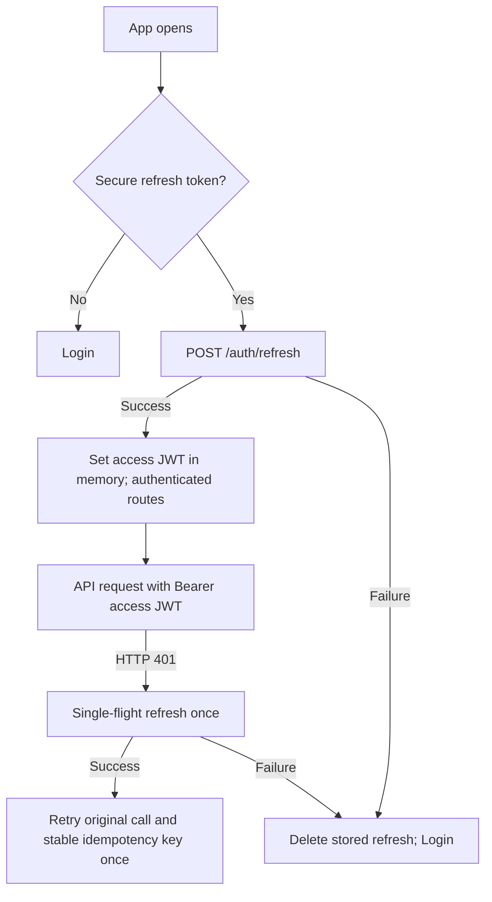

# Flutter Scaffold and shadcn UI Specification

**Updated v5.0:** Flutter does **not** contain `supabase_flutter`, call Supabase Auth, read/write Postgres or sign JWTs. It calls **Node.js/Express REST** using short-lived backend-issued access JWT. Supabase hosts the **database only**.

## 1. Flutter libraries
- `shadcn_ui` — Flutter-native UI components styled in shadcn spirit, **not** React package.
- `flutter_riverpod` — domain and async state/controllers.
- `go_router` — nested routes and auth redirects.
- `dio` — HTTPS/JSON REST, auth and retry interceptors.
- `flutter_secure_storage` — device keychain/keystore storage for refresh token; access JWT mainly in memory.
- `intl` — INR displays, date/time formatting.
- Optional after foundation: `freezed`, `json_serializable`, `build_runner`, `pdf`, `printing`, `share_plus`, `csv` or compatible XLSX package.
- Unit, widget and integration testing packages pinned compatible with Flutter SDK.

```bash
flutter create train_fund_manager
cd train_fund_manager
flutter pub add shadcn_ui flutter_riverpod go_router dio flutter_secure_storage intl
flutter pub add --dev flutter_lints
flutter analyze
flutter test
```

Verify compatible Flutter/Dart and library versions when implementing; commit `pubspec.lock`.

## 2. Complete suggested Flutter scaffold

```text
mobile/
├── pubspec.yaml
├── pubspec.lock
├── analysis_options.yaml
├── .env.example              # PUBLIC API_BASE_URL only
├── android/
├── ios/
├── assets/
│   └── icons/
├── lib/
│   ├── main.dart
│   ├── bootstrap.dart
│   ├── app/
│   │   ├── app.dart
│   │   ├── router.dart
│   │   └── app_providers.dart
│   ├── core/
│   │   ├── config/
│   │   │   └── api_config.dart
│   │   ├── network/
│   │   │   ├── dio_provider.dart
│   │   │   ├── api_client.dart
│   │   │   ├── auth_interceptor.dart
│   │   │   ├── api_errors.dart
│   │   │   └── retry_policy.dart
│   │   ├── auth/
│   │   │   ├── token_store.dart
│   │   │   ├── auth_repository.dart
│   │   │   ├── auth_controller.dart
│   │   │   └── current_user.dart
│   │   ├── money/
│   │   │   ├── money.dart
│   │   │   ├── money_parser.dart
│   │   │   └── money_formatter.dart
│   │   ├── ui/
│   │   │   ├── theme.dart
│   │   │   ├── tokens.dart
│   │   │   └── widgets/
│   │   │       ├── app_button.dart
│   │   │       ├── app_text_field.dart
│   │   │       ├── money_input.dart
│   │   │       ├── empty_state.dart
│   │   │       ├── error_state.dart
│   │   │       ├── balance_card.dart
│   │   │       └── confirmation_dialog.dart
│   │   └── utils/
│   │       ├── date_formatters.dart
│   │       └── validators.dart
│   ├── features/
│   │   ├── login/
│   │   │   ├── presentation/login_screen.dart
│   │   │   └── presentation/login_controller.dart
│   │   ├── dashboard/
│   │   │   ├── data/dashboard_repository.dart
│   │   │   └── presentation/dashboard_screen.dart
│   │   ├── packagers/
│   │   │   ├── data/packager_repository.dart
│   │   │   ├── domain/packager.dart
│   │   │   └── presentation/
│   │   │       ├── packagers_screen.dart
│   │   │       ├── packager_form_screen.dart
│   │   │       └── packager_detail_screen.dart
│   │   ├── bookings/
│   │   │   ├── data/booking_repository.dart
│   │   │   ├── domain/booking.dart
│   │   │   ├── domain/booking_financials.dart
│   │   │   └── presentation/
│   │   │       ├── booking_list_screen.dart
│   │   │       ├── create_booking_screen.dart
│   │   │       ├── booking_detail_screen.dart
│   │   │       ├── booking_form_controller.dart
│   │   │       └── collection_dialog.dart
│   │   ├── wallets/
│   │   │   ├── data/wallet_repository.dart
│   │   │   ├── domain/wallet.dart
│   │   │   └── presentation/
│   │   │       ├── wallet_list_screen.dart
│   │   │       ├── wallet_detail_screen.dart
│   │   │       └── wallet_entry_dialog.dart
│   │   ├── reports/
│   │   │   ├── data/report_repository.dart
│   │   │   ├── presentation/reports_screen.dart
│   │   │   └── services/export_service.dart
│   │   └── settings/
│   │       └── presentation/settings_screen.dart
│   └── generated/           # only if code generator used
├── test/
│   ├── unit/
│   │   ├── money_parser_test.dart
│   │   ├── booking_financials_test.dart
│   │   └── auth_controller_test.dart
│   ├── widget/
│   │   └── create_booking_form_test.dart
│   └── integration/
│       └── login_create_booking_flow_test.dart
└── README.md
```

`backend/` lives alongside `mobile/` in the monorepo (see `11_BACKEND_NODEJS_EXPRESS_JWT_IMPLEMENTATION.md`). Database migrations live in `backend/prisma/migrations/`, not inside Flutter.

## 3. Navigation map

```text
/splash -> load secure refresh token, attempt one refresh
/login -> public screen
/app/dashboard -> authenticated
/app/packagers -> list
/app/packagers/new -> create
/app/packagers/:id -> profile and statement
/app/bookings -> list
/app/bookings/new -> exact booking form
/app/bookings/:id -> financial detail + receipt history
/app/wallets -> balances
/app/wallets/:id -> ledger
/app/reports -> reports + export
/app/settings -> change password + logout
```

`go_router` must redirect based on `AuthController` state (`initializing`, `authenticated`, `unauthenticated`). Never rely solely on route guards for security; **Node.js/Express** enforces it again.

## 4. Booking form UI contract

```text
[Select Packager            v]
[Boarding Station            ]
[Destination Station         ]
[Journey Date            📅  ]
[Train Name or Number        ]  <-- EXACTLY ONE TEXT FIELD
[Train Ticket Booking Price ₹]
[Service Charge            ₹]
[Total Collected Fund       ₹]
[Wallet Deducted Fund       ₹]
[Wallet                     v]  <-- visible/required only if deduction > 0
---------------------------------
Total Payable              ₹xx.xx
Total Collected            ₹xx.xx
Remaining Balance Due      ₹xx.xx
(or Advance / Credit if overpaid)
[Save Booking]
```

One train field accepts either name `Kerala Express` or number `12626`. Form must not show PNR, booking reference, train status, passenger/seat/coaches or ticket confirmation. Differentiate **collected from packager** and **deducted from wallet** with labels and helper text.

## 5. UI design system
- Flutter-native shadcn-style **cards, inputs, buttons, selects, calendar, dialogs, labels, tabs, badge-like status for payment due/credit only where useful**.
- Consistent compact typographic hierarchy, light/dark support if feasible, 8px spacing rhythm, mobile touch targets and accessible contrast.
- One primary CTA per screen. Use clear due/credit colors but never convey meaning solely by color.
- Search packagers with keyboard and type-ahead, show number of bookings and net balance.
- For each wallet show current balance, top-ups, deductions and refunds separately.
- Do not label fee billed as profit earned. Dashboard cards specify date range and metric definition.

## 6. Domain and parsing rules

```dart
// Conceptual API: use integer paise, never double, for financial models.
class Money {
  final int paise;
  const Money(this.paise);
}

// Parsing examples:
//  "8500" -> 850000
//  "8500.50" -> 850050
//  "12.345" -> invalid
//  "-1" -> invalid where entry must be nonnegative
```

Preview payable and due locally using integers, but replace preview after save with API-confirmed amounts. Date picker returns YYYY-MM-DD without UTC day-shift.

## 7. Auth and request interceptor contract



- Never embed JWT signing key, database password, Supabase anon/service key in Flutter config.
- Do not cache password or refresh credential in `shared_preferences` or local plaintext files.
- Avoid logging HTTP Authorization, login password or refresh payload.
- Ensure concurrency single-flight prevents multiple simultaneous refresh attempts consuming the same token.
- For financial POST retries retain same `Idempotency-Key` and payload; never silently retry with a new UUID.
- Handle offline, `429`, `401`, `403/404`, `409` and `5xx` states with accurate feedback.

## 8. Repository example

```dart
class BookingRepository {
  BookingRepository(this.client);
  final Dio client;

  Future<Map<String, dynamic>> createBooking({
    required Map<String, dynamic> body,
    required String idempotencyKey,
  }) async {
    final response = await client.post(
      '/bookings',
      data: body,
      options: Options(headers: {'Idempotency-Key': idempotencyKey}),
    );
    return Map<String, dynamic>.from(response.data as Map);
  }
}
```

Example assumes Dio BaseOptions points to `/api/v1`, auth interceptor supplies Bearer access token, and JSON DTO parsing is added later. Never send trusted `owner_id`.

## 9. Tests and exports
- Widget test validates ONE train field, correct conditional wallet selection and live calculated due.
- Auth tests cover secure restore, refresh single-flight, logout clearing and 401 replay bounded to one attempt.
- Unit test price/service/collection exact paise; backend test remains source of truth for committed money.
- Exports use API-supplied authorized report data and Flutter-side PDF/CSV/XLSX generation; avoid storing report PDFs in Supabase Storage (out of scope).
