# Module-by-Module Development Roadmap and Gates

**Version 5.0:** Use **Flutter + `shadcn_ui` + Node.js/Express custom JWT backend + Supabase PostgreSQL database only**. Build in order; stop at each gate until tests pass. Supabase Auth is forbidden.

## Module summary

| Module | Name | Critical output | Depends on |
|---|---|---|---|
| M00 | Monorepo and skeleton | Flutter shell + Express health | None |
| M01 | Supabase DB and migrations | Connected private schema, app roles | M00 |
| M02 | Custom JWT auth | Owner bootstrap, login/refresh/logout | M01 |
| M03 | Flutter auth integration | Secure token restore, guarded navigation | M02 |
| M04 | Packager management | Full owner-scoped CRUD/archive | M03 |
| M05 | Wallet foundation | Opening balance and top-up ledger | M04 |
| M06 | Atomic booking creation | Exact simplified form + initial entries | M05 |
| M07 | Collections and summary engine | Partial receipts, balance due/credit | M06 |
| M08 | Wallet advanced movements | Debit, actual refund, reversal/corrections | M07 |
| M09 | Dashboard and reports | Current and time-window metrics, export | M08 |
| M10 | Security, performance and QA | Integration/authorization/concurrency suite | M09 |
| M11 | Deployment, recovery and handover | Hosted API, Android build, backup/restore | M10 |

## M00 — Repository, development environment and UI/backend skeleton
**Actions:** Create top-level `mobile/`, `backend/`, `docs/` and `.github/workflows/`. Initialize Flutter with `shadcn_ui`, Riverpod, GoRouter, Dio; build theme/login and empty navigation shells. Initialize Node.js + Express + TypeScript with `/health`, Zod validation, structured errors, ESLint, Vitest and Supertest. Copy these MD documents into `docs/` and write environment examples without credentials. Decide development Postgres project separation.

**Deliverables:** `flutter analyze`, `flutter test`, TypeScript lint/test and local Express health check pass. No Supabase Flutter SDK.

**Gate:** Agent can launch mobile shell and backend independently; `README` clearly explains startup.

## M01 — Supabase database only, Prisma ORM and Prisma Migrate
**Actions:** Create Supabase project and obtain server-only PostgreSQL URL from Connect. Verify connection mode/TLS. Configure Prisma ORM v7, adapter-pg runtime connection, reviewed Prisma Migrate migrations, and explicit interactive transaction boundaries. Create private `app` schema, runtime restricted DB role and migrations for `app_users`, `auth_sessions`, `refresh_tokens`, packagers, bookings, wallets, ledgers, idempotency, audit. Disable/exclude Data API access to private objects. Add seed fixtures in **development only**.

**Gate:** Prisma Migrate apply and reviewed rollback tested in isolated development DB; runtime role cannot mutate schema or access other schemas; app connects using backend only.

## M02 — Custom backend authentication and JWT
**Actions:** Build admin-only bootstrap owner CLI, normalize email, Argon2id password hashing, login (generic bad credentials), RS256 JWT signer/verifier with `iss/aud/sub/sid/jti/exp/iat/nbf/typ`, session validation, opaque refresh-token hash storage, atomic rotation/reuse detection, logout/session revoke, `/auth/me`, rate limits and change-password. Store private key only in deployment secret manager, never in repo/app. No public signup.

**Gate:** Valid/invalid login tests, signature/claim tests, expiry, session revocation, logout, rotated token reuse and concurrent refresh tests pass. No calls to Supabase Auth.

## M03 — Flutter JWT API integration
**Actions:** Dio client and error parser; secure refresh storage; access JWT in memory; one-at-a-time refresh interceptor; bounded 401 replay; auth controller/router guards; login, splash and settings/logout; API URL config as nonsecret. Verify device restart session restore and remote logout failure.

**Gate:** Login reaches protected `/auth/me`; expired access token transparently refreshes; revoked session redirects to login; no credentials leaked in logs.

## M04 — Packager directory
**Actions:** CRUD API with owner-scoped filters, validation, archive; Flutter list/search/add/edit/detail screens; duplicate names allowed; no customer/packager login. Add owner-access tests and pagination.

**Gate:** Packager A can have multiple bookings eventually; another owner's objects cannot be found, read or modified.

## M05 — Wallet baseline
**Actions:** Create wallet with one-time opening balance; top-up API as immutable entry, wallet query/aggregate, Flutter wallet screens, sufficient-funds query and locking helper. Add audit, idempotency, balance unit tests. Never edit opening balance after activity.

**Gate:** Opening ₹20,000 + top-up ₹500 = ₹20,500; retries cannot double top-up.

## M06 — Simplified booking and atomic initial finances
**Actions:** Build exact single-train booking form. Backend request DTO excludes PNR/status/reference/passenger fields; validates packager and wallet ownership; processes ticket price, fee, optional receipt and wallet debit atomically under idempotency key. Lock wallet, reject overdraft, rollback all changes on failure. Return authoritative payable/collected/deducted/due.

**Gate:** Example ₹10,000 + ₹1,000 − ₹8,500 = ₹2,500 due despite ₹10,000 wallet spending; one booking, one receipt, one debit only on retry.

## M07 — Collections and derived balances
**Actions:** Additional customer receipt endpoint, booking detail transaction timeline, `get booking financials` aggregate queries, packager statement and due/credit display; deliberate overpayments appear as credits. Test multi-booking and receipt concurrency.

**Gate:** Partial payment affects customer due only, never wallet; backend totals match UI.

## M08 — Advanced wallet operations and corrections
**Actions:** Additional booking debit, actual wallet refund, customer refund, receipt reversal, debit reversal, manual adjustments with mandatory reason and original-entry association. Use append-only ledgers and event auditing, cap reversals/refunds. Build appropriate dialogs.

**Gate:** No possible double reversal/over-refund, wallet cannot be overdrawn; original entries remain present.

## M09 — Dashboard, reports and local export
**Actions:** Dashboard API summaries, packing filters, receipt/fee/wallet date semantics, detail pagination, packager statement, CSV/PDF/XLSX exports from authenticated responses. The wallet provider balance and packager outstanding must remain separate cards.

**Gate:** Reports reconcile with booking and ledger counts and amounts; no date-window mismatch or duplicated join sums.

## M10 — Quality/security gate
**Actions:** Unit/widget/API integration tests against real Postgres staging, JWT/session/Argon2 security cases, owner isolation tests, rate limiting, concurrency/idempotency stress, migration review, backup restoration drill, dependency check, logs redaction, credential scan and load test. Verify Supabase Data API not exposing private app tables.

**Gate:** All test matrix items in `08_TESTING_SECURITY_AND_RELEASE.md` pass; any financial mismatch blocks release.

## M11 — Deployment and release
**Actions:** Host Node.js/Express behind HTTPS with secrets; configure production DB connection (direct/session pooler as environment permits), migrations using privileged CI, database backups and manual restore plan, monitoring/alerts and rotation runbook. Configure Flutter signed release, versioned API URL and crash handling. Create user/operator guide and handover.

**Gate:** Real Android device login, create-booking, collection and logout smoke test; staging data segregated; documented rollback strategy and tested recovery.

## Execution dependency flow

```mermaid
flowchart LR
 M00[00 Foundation] --> M01[01 Supabase PostgreSQL]
 M01 --> M02[02 Backend JWT]
 M02 --> M03[03 Flutter Auth]
 M03 --> M04[04 Packagers]
 M04 --> M05[05 Wallets]
 M05 --> M06[06 Booking + atomic finance]
 M06 --> M07[07 Collections]
 M07 --> M08[08 Corrections]
 M08 --> M09[09 Reports]
 M09 --> M10[10 Security QA]
 M10 --> M11[11 Deploy]
```

## Agent work protocol
For every module, read its referenced files; define files to modify and tests first; implement only the module's scope; report tests passed/failed; update API schema docs; do not overwrite architecture or financial invariants. If a prerequisite is missing, implement the missing prerequisite rather than inventing an alternate technology.

### Prisma/Node implementation gates (must apply to every module)
- M00 produces working `backend/src/app.ts` and `src/main.ts` with Express and TypeScript; `npm ci`, TypeScript check and `/health` pass.
- M01 generates valid Prisma schema/migrations for private `app` schema and adapter-based PostgreSQL connection; use an isolated test DB.
- M02 issues access JWT via `jose`, hashes passwords with `argon2`, and rotates opaque refresh tokens with transaction-safe session revocation.
- M06/M07/M08 use Prisma interactive transactions, wallet row locking, idempotency keys and independent journals; tests run against a real isolated PostgreSQL DB.
- M09 exposes report endpoints through Express and serializes all `BigInt` financial amounts safely.
- M11 deploys a Node.js server using a managed HTTPS process/container, not a Python runtime.
