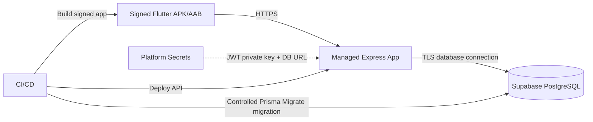

# Deployment, Operations, Backup, and Handover

**System:** Flutter + `shadcn_ui` mobile, hosted **Node.js/Express custom JWT backend**, **Supabase PostgreSQL database only**. All production credentials live server-side. This is a deployment **plan**, not a claim that any infrastructure has been provisioned.

## 1. Environments

| Environment | Mobile | Node.js/Express | PostgreSQL |
|---|---|---|---|
| Local development | Emulator/device, local API URL | Local Node.js | Separate development Supabase project or isolated local PostgreSQL |
| Staging | Internal test build | Staging HTTPS URL | Separate staging DB/project |
| Production | Signed Android build | Managed HTTPS API | Production Supabase DB/project |

Do not use production data in development/staging. Seed only fictitious packagers and financial records.

## 2. Deployment topology



Host Node.js/Express on a platform capable of running a Node.js web service over HTTPS. Confirm pricing, cold-start policies, network IPv4/IPv6 support, region and persistent availability before selecting a vendor. Supabase is not hosting Node.js/Express; it only hosts PostgreSQL in this design.

## 3. Database connection options
- For long-running Node.js host with IPv6 or paid IPv4 add-on: Supabase direct connection may be appropriate.
- For persistent backend on IPv4-only host: Supabase **session pooler** is the documented alternative.
- For highly bursty serverless executions: evaluate transaction pooler, carefully checking driver/prepared-statement behavior; not the default deployment.
- Copy official connection string from Supabase Dashboard → Connect; never invent host names or passwords.
- Use verified TLS (`verify-full` with trusted CA where configured) and capped Prisma ORM pool sizes to avoid exhausting a small DB plan.
- Keep DB URL and migration credentials out of the Flutter APK and code repository.

## 4. Required server secrets

```text
DATABASE_URL                      # runtime least-privileged account
MIGRATION_DATABASE_URL            # privileged role, used only by controlled migration job
JWT_PRIVATE_KEY_PEM / secret ref  # asymmetric signing
JWT_PUBLIC_KEYS_JSON              # active/retired key verification set
JWT_ACTIVE_KID                    # active signing key identifier
JWT_ISSUER
JWT_AUDIENCE
ACCESS_TOKEN_TTL_SECONDS
REFRESH_TOKEN_TTL_DAYS
```

Separate runtime and migration secrets. Never print secrets in build logs. Use secret references/mounted files for private keys when possible. Flutter receives only the HTTPS `API_BASE_URL`, no secrets.

## 5. First deployment steps
1. Verify application source and tests, pin dependency locks.
2. Provision separate Supabase development/staging/production PostgreSQL projects.
3. Set up `app` schema and restricted DB role with controlled Prisma Migrate migrations.
4. Turn off Data API if allowed by project needs or exclude/ungrant `app` objects from PostgREST.
5. Generate secure RS256 keypair and store backend private key in managed secrets; document rotation policy.
6. Set up HTTPS Node.js host and health/readiness paths, sensible limits/timeouts.
7. Run database migration with privileged CI only; do not run production migration automatically from every API pod startup.
8. Bootstrap operator from secure CLI/admin channel; there is no public registration endpoint.
9. Smoke-test login/refresh/bookings/collection/wallet/logout on staging and production appropriately.
10. Produce signed Android build with production API URL, test physical device and distribute internally or publish if approved.

## 6. Backup and data recovery
- Review current Supabase plan-specific backup/PITR and retention features; do not assume free continuous PITR.
- Define an independent backup export schedule if plan requires it; encrypt and restrict the backups, and ensure `app_users` and finance ledgers are included.
- Schedule restore rehearsals to a separate isolated project; verify audit history, wallet totals, users and session records. After sensitive recovery events, revoke sessions and force re-login if session integrity is uncertain.
- Track migration/version compatibility and create rollback script or compensating migration plan; destructive rollback needs explicit approval.
- Decide RPO/RTO after operational context is known, rather than claiming unsupported recovery guarantees.

## 7. Monitoring and safety operations
- Log HTTP timing/status, request/correlation ID and limited resource IDs, never password, Authorization, refresh token or full statement data.
- Monitor rate-limited login attempts, auth failures, refresh reuse detections, DB connection saturation, 5xx spikes and financial idempotency conflicts.
- Alert on repeated ledger invariants failing or rejected funds operations; no silent reconciliation corrections.
- Run scheduled book-to-ledger consistency checks in a protected backend admin process (read-only diagnostics initially).
- Handle JWT key rotation: keep prior public key available until previously signed short-lived access JWTs expire; re-sign with newly active private key; avoid key reuse between staging and production.
- On suspected compromise revoke sessions, rotate affected secrets, review audit/DB access and restore known-good configuration.

## 8. Cost considerations
The old no-backend design would rely on Supabase Auth, but **custom JWT requires a running backend**. Budget for Node.js hosting, managed PostgreSQL, outbound bandwidth, monitoring/logs, backup storage and optional domain. Free service tiers, if available, may sleep or impose quotas; verify current commercial terms before budgeting. Flutter app build itself can be developed locally.

## 9. Operator handover
- Write guide to login and securely store owner password; warn against sharing one account between operators.
- Explain packager creation, one-field train input, creating booking, recording receipts, wallet deduction, reversing mistakes and producing statements.
- Clarify **wallet deducted amount is not subtracted from customer due**.
- Provide support diagnostics checklist: API status → JWT/session issue → database connectivity → ownership/validation → idempotency result → wallet sufficiency.
- Include tested restore procedure, environment ownership, rotation owner, release history and emergency contacts before launch.

## 10. Source references
- Supabase Postgres connection guide: https://supabase.com/docs/guides/database/connecting-to-postgres
- Supabase DB protection: https://supabase.com/docs/guides/database/secure-data
- OWASP password storage: https://cheatsheetseries.owasp.org/cheatsheets/Password_Storage_Cheat_Sheet.html
- OWASP mobile app token security: https://cheatsheetseries.owasp.org/cheatsheets/Mobile_Application_Security_Cheat_Sheet.html
