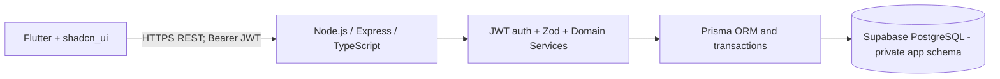

# Train Fund Manager — Updated Master Project Plan (Node.js + JWT)

**Version:** 5.0 · 11 October 2026  
**Stack:** Flutter + Flutter-native `shadcn_ui`; Node.js LTS + Express.js + TypeScript; Zod; Prisma ORM; Supabase PostgreSQL as database only; custom RS256 JWT + Argon2id + rotating opaque refresh tokens.

## Product
A mobile system for managing bulk train-ticket booking requests from packagers (agents/customers). Each packager can have multiple bookings. One booking records **boarding station, destination station, journey date, one train name-or-number field, train ticket booking price, service charge, initial total collected fund and wallet deducted fund**. Derived total payable and balance fund are shown instantly and confirmed by the API. PNR, booking reference, passenger details and ticket status are not features.

## Financial rules
- Total payable = ticket booking price + service charge.
- Total collected = all actual customer receipts minus refunds/reversals.
- Signed balance = total payable − net collected; positive = due, negative = customer credit.
- Wallet deducted = operator's wallet spending and is tracked **separately**; it does not reduce customer due.
- Fund balance = ticket booking price − wallet deduction; collections and service charge are separate.
- Example: ticket ₹10,000, service ₹1,000, collected ₹8,500, wallet deduction ₹10,000 → payable ₹11,000, due **₹2,500**.
- Financial writes are atomic, ledger-based, audited, owner-scoped, idempotent and use integer paise.

## Architecture

## Screens
Login, Dashboard, Packager Directory, Add/Edit Packager, Packager Detail, Booking List, Create Booking with Wallet Deduction from the operator's own wallet, Booking Detail with customer collections and later deductions, Reports, Settings and Logout. Separate wallet management screens have been retired from the current UI; historical database records remain available to the backend.

## 12 development modules

| Module | Output |
|---|---|
| M00 | Flutter + Node/Express TypeScript monorepo foundation |
| M01 | Supabase PostgreSQL private schema and Prisma migrations |
| M02 | JWT login/refresh/logout + owner bootstrap |
| M03 | Flutter secure token session + guarded routes |
| M04 | Packagers CRUD and owner-scoped API |
| M05 | Wallets, opening balance, top-up and locking |
| M06 | Atomic create-booking + initial collection/deduction |
| M07 | Partial collection and derived balance engine |
| M08 | Refunds/reversals and immutable ledger corrections |
| M09 | Dashboard, packager statements and exports |
| M10 | Unit, integration, auth, security and money tests |
| M11 | Node backend deployment, DB migration, mobile release and recovery |

## Documents to follow
Read the included directory `Train_Fund_Manager_NodeJS_Documentation/` beginning at `00_README_START_HERE.md`. `02` specifies architecture, `03` and `13` database design, `04` money flow, `05` REST orchestration, `06` Flutter scaffold, `07` ordered modules, `09` AI-agent instructions, `10` locked stack, `11` backend code structure and `12` deployment. Follow each module gate and do not substitute the old FastAPI stack.

## MVP assumptions
Single owner/operator account provisioned by server-only CLI; no packager login, no public signup, online-first, manually entered bookings/payments/wallet movements; no direct railway or financial-provider integration.
